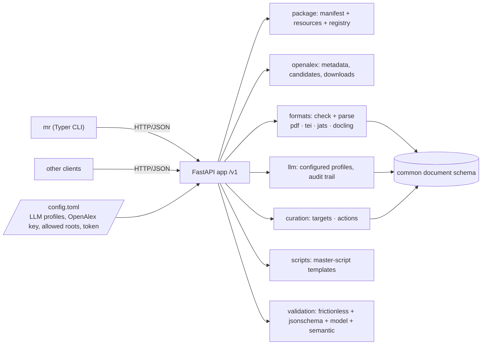
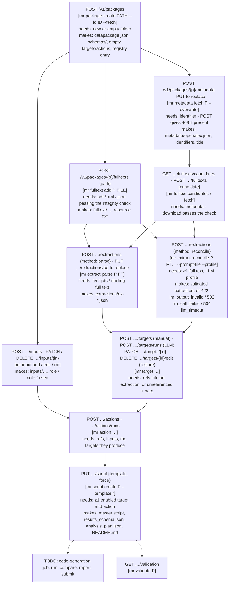
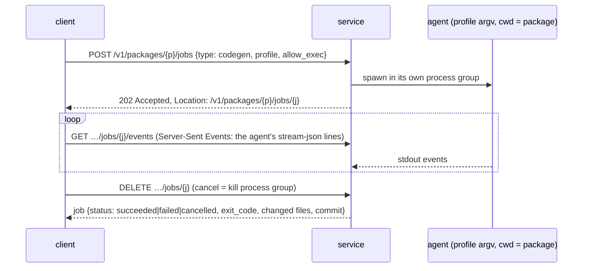

# MetaReader CLI: design

A local REST service and a thin CLI client for building computational-reproducibility packages for a
paper, without Zotero. The workflow follows the MetaReader Zotero plugin. The service owns all file and
LLM operations. The CLI only sends HTTP requests, so any other client can use the same API.

Status: phase 1 (everything up to master-script templates) is implemented and tested. Later phases are
listed under [TODO](#todo-later-phases).

> **Implemented in** notes (like this one) say which files implement each component. Paths are relative to
> `src/metareader/`.

## Principles

- **The package folder is the state.** Everything about a package is in its own folder, described by a
  [Frictionless Data Package](https://datapackage.org) manifest (`datapackage.json`). The service keeps only
  a registry (package id → folder).
- **One source of truth for schemas.** Every custom JSON structure is a Pydantic model. JSON Schemas
  (`schemas/*.schema.json`) and the schema reference (`docs/schemas.md`) are generated from those models, and
  a test fails if they drift. See [Schemas and validation](#schemas-and-validation).
- **Nothing executable comes from the caller.** LLM commands are *profiles* in the service config. Callers
  choose a profile by name and can pass prompt text, but never argv. Local paths can be restricted to
  configured roots.
- **Non-destructive curation.** LLM output is stored as the LLM produced it. User changes go in an overlay,
  so they can be restored.
- **Modular formats and templates.** Each full-text format and each master-script template has one module or
  folder. Adding one means adding a file and registering it.

## Components



> **Implemented in:** CLI `cli.py` · HTTP app `api/app.py`, bodies `api/models.py`, problem catalog
> `api/problems.py` · package and registry `package.py` · config `config.py` · OpenAlex `openalex.py`,
> `metadata.py`, `identifiers.py` · full texts `fulltexts.py` · formats `formats/` · extractions
> `extractions.py` · LLM runner `llm.py`, prompts `prompts/*.md` · inputs `inputs.py` · targets/actions
> `curation.py` · scripts `scripts.py`, `templates/` · validation `validation.py` · schemas `schemas/`.

## Package layout

```
<package>/
  datapackage.json            Frictionless manifest: every file below is a resource (path, bytes, sha256,
                              jsonSchema, metareader: {kind, …})
  schemas/*.schema.json       copies of the JSON Schemas the resources refer to (jsonSchema)
  metadata/openalex.json      OpenAlex work record
  fulltext/<file>             added full texts (pdf / TEI / JATS / Docling JSON), unchanged
  extractions/<name>.json     common document schema (parsed or reconciled)
  inputs/…                    input files (data / code / other); zip archives unpacked under inputs/<stem>/
  targets.json                curated targets (manual + LLM runs with overlays)
  actions.json                curated actions (the former "analysis plan" steps)
  results_schema.json         \  written by the script step: enabled targets, the resolved plan
  analysis_plan.json          /  (load steps + actions + results step), the master script, README.md
  <master script>, README.md
  llm-calls/<call-id>/        prompt.txt, stdout.txt, stderr.txt, call.json for every LLM call (audit
                              trail; not listed as resources)
```

> **Implemented in:** `package.py` (`init_package` writes the minimal package; `Package.edit()` is the only way
> manifests change: lock, load, validate, atomic write).

## User flow and calls

Each box is one call: **requires → produces**. The CLI command is shown in brackets.



## HTTP conventions

The API follows common REST practice, so generic tooling (OpenAPI generators, HTTP caches, problem-aware
clients) works without special cases.

| Topic | Convention |
|---|---|
| Versioning | Everything under `/v1`. |
| Documentation | OpenAPI 3.1 generated from the code: Swagger UI at `/docs`, ReDoc at `/redoc`, spec at `/openapi.json`; committed copy `docs/openapi.json` (test checks it is current). Every endpoint has a summary, tags, typed request/response models and its documented error responses. |
| Resources | Plural nouns, ids in the path: `/packages/{pkg}/targets/{id}`. Sub-resources instead of verbs: LLM runs are `…/targets/runs`, the user's overlay on an LLM entry is `…/targets/{id}/edit` (`DELETE` = restore). |
| Methods | `POST` creates (201 + `Location`) and returns 409 if the thing exists. `PUT` replaces explicitly (metadata, extractions, script). `PATCH` is a JSON merge patch (RFC 7396; `application/merge-patch+json` or JSON). `DELETE` returns 204. |
| Errors | RFC 9457 `application/problem+json`: `type` (`/v1/problems/<code>`, resolvable), `title`, `status`, `detail`, `instance`, plus `code`, `request_id` and problem-specific members (`errors`, `stage`, `problems`, …). Catalog at `GET /v1/problems`; a test checks every code raised in the code is catalogued. |
| Validation | Bodies are validated against their models before anything runs (`request_invalid`, 422). Unknown fields are rejected, so a caller can't sneak in e.g. `argv`. |
| Concurrency | Package-scoped responses carry an `ETag` (hash of the manifest). Unsafe requests may send `If-Match`; on mismatch the answer is 412 `precondition_failed`. Writes are serialized per package and files are written atomically. |
| Auth | Bearer token (OpenAPI `HTTPBearer` scheme), enforced when the config sets `token`. `/v1/health` and `/v1/problems` are open. Binds to 127.0.0.1 by default. |
| Tracing | `X-Request-ID` echoed or generated on every response, also in problem bodies. |
| Long operations | LLM calls are synchronous for now (the profile's timeout bounds them; the CLI waits without a timeout). The code-generation agent will use the job pattern below (202 + job resource). |

> **Implemented in:** `api/app.py` (routes, middleware for request id and ETag, `get_pkg` for If-Match, `auth`,
> exception handlers), `api/problems.py` (catalog, `Problem` model), `api/models.py` (bodies incl. generated
> merge-patch models), `schemas/export.py` (writes `docs/openapi.json`).

### Endpoints

| Method and path | Body / query | Result | Problem codes |
|---|---|---|---|
| `GET /v1/health` · `GET /v1/problems[/{code}]` | | status · problem types | |
| `GET /v1/llm-profiles` · `GET /v1/templates` | | profiles (argv read-only) · script templates | |
| `POST /v1/packages` | `{path, identifier?, fetch_metadata?, adopt?}` | 201 summary | `package_exists`, `folder_not_empty`, `path_not_allowed`, `invalid_identifier` |
| `GET /v1/packages` · `GET …/{pkg}` · `GET …/{pkg}/manifest` | | summaries · `datapackage.json` | `not_found`, `package_missing` |
| `DELETE /v1/packages/{pkg}` | | 204, unregisters (files stay) | |
| `GET …/{pkg}/validation` | | `{valid, errors[], warnings[]}` (each with `stage`) | |
| `POST` / `PUT …/{pkg}/metadata` | `{identifier?}` | 201 / 200 summary | `metadata_exists`, `identifier_conflict`, `no_identifier`, `openalex_not_found`, `openalex_failed` |
| `GET …/{pkg}/metadata` | | the OpenAlex record | |
| `GET …/fulltexts` · `GET …/fulltexts/{ft}[/content]` | | resources · the file | |
| `GET …/fulltexts/candidates` | | `{candidates[], notes[]}` | `metadata_missing` |
| `POST …/fulltexts` | `{path}` or `{candidate}`, `name?` | 201 resource | `integrity_check_failed` (+`problems`), `duplicate_fulltext`, `download_failed` |
| `DELETE …/fulltexts/{ft}` | | 204 | `in_use` |
| `POST …/extractions` · `PUT …/extractions/{x}` | `{method:"parse", fulltext}` | 201 / 200 resource | `not_parseable`, `parse_failed`, `extraction_exists` |
| | `{method:"reconcile", sources[], prompt?, instructions?, profile?}` | | `llm_output_invalid` (+`stage`, `errors`, `raw_output`), `llm_call_failed`, `llm_timeout`, `unknown_profile` |
| `GET …/extractions[/{x}]` | `?view=document\|outline` | resources · document JSON or text with ids | |
| `DELETE …/extractions/{x}` | | 204 | `in_use` |
| `POST …/inputs` · `GET …/inputs[/{in}]` | `{path, role?, note?, unpack?}` | 201 resources (archive + members) | `invalid_archive`, `not_a_file` |
| `PATCH` / `DELETE …/inputs/{in}` | `{role?, note?, used?}` | resource · 204 | `archive_member`, `in_use` |
| `GET …/targets` | `?view=effective\|raw&include_disabled` | `[{item, origin}]` or `targets.json` | |
| `POST …/targets` | target fields | 201 target | `request_invalid`, `invalid_reference` |
| `GET` / `POST …/targets/runs` · `GET` / `PATCH …/targets/runs/{run}` | `{extraction, scope?, instructions?, prompt?, profile?}` · `{disabled}` | runs · 201 run | `unknown_ids`, LLM codes |
| `GET` / `PATCH` / `DELETE …/targets/{id}` | merge patch incl. `disabled` | `{item, origin}` · 204 | `schema_invalid`, `invalid_reference`, `manual_item`, `llm_entry`, `in_use` |
| `DELETE …/targets/{id}/edit` | | restored LLM version | `manual_item` |
| `…/actions…` | same as targets | | |
| `GET` / `PUT …/script` | `{template, force?}` | files · 201 / 200 `{created, files, command}` | `unknown_template`, `nothing_to_script`, `script_modified` |

**LLM error classes (reconcile, target/action runs):**
- `llm_call_failed` (502): the configured command could not start or exited non-zero (stderr included).
- `llm_timeout` (504): the call ran longer than the profile's `timeout_s`. The whole process group is
  killed.
- `llm_output_invalid` (422): the call succeeded but its output is unusable. `stage` says where it failed:
  `json` (no parseable JSON object) or `schema` (does not validate). The raw output is kept in
  `llm-calls/<id>/stdout.txt`.

For target/action runs, *individual* invalid items do not fail the call. They are stored in the run's
`rejected` list with their errors, and the valid items are kept.

> **Implemented in:** `llm.py` (`run`, `build_argv`, `extract_json`, `output_invalid`), used by
> `extractions.reconcile` and `curation.Curation.generate`.

## Common document schema

Every parser and the reconcile call produce the same structure (`schemas/document.schema.json`):

```
Document
  title, source {method: parse|reconcile, format, fulltexts[], llm_call?}
  sections[]  {id "sec3", title, level, paragraphs[]}           flat list in reading order; level = nesting
     paragraphs[] {id "sec3.p2", sentences[], boxes?}
        sentences[] {id "sec3.p2.s1", text, boxes?}
  figures[]   {id "fig1", label, section, caption[] (sentences "fig1.s1"), boxes?}
  tables[]    {id "tab1", label, section, caption[], rows[][], boxes?}
```

The ids are hierarchical and readable, so a reference such as `{extraction: "ex-grobid", id: "sec3.p2.s1"}`
also says where it points. Parsers and the LLM produce a **DocumentDraft** (the same content without ids;
figures and tables nested in the section where they appear). `build_document` assigns all ids, so there is
one id scheme for every source, and the LLM never has to invent ids.

**Format modules** each provide `sniff`, `check(path) → problems + notes` (integrity) and optionally
`parse(path) → DocumentDraft`. TEI and JATS are declared as an `XmlMapping`: element names for sections,
headings, paragraphs, sentences, figures and tables, regions to read, elements to skip, transparent
wrappers, and coordinates. A shared walker interprets the mapping. Docling has a label → role table. XML
is parsed without DTDs, entities or network access.

| Format | Detected by | Check | Parse |
|---|---|---|---|
| pdf | `%PDF-` header | opens with pypdf, ≥ 1 page, not encrypted (notes: page count, missing text layer) | not parseable (reconcile input only) |
| tei | XML root `TEI` / `teiCorpus` | well-formed, has body or abstract | `XmlMapping` (uses GROBID `<s>` and `coords` when present) |
| jats | XML root `article` | well-formed, has body or abstract | `XmlMapping` (floats inside paragraphs are lifted out) |
| docling | JSON `schema_name: DoclingDocument` | valid JSON with `body`, non-empty `texts` | label table |

> **Implemented in:** `schemas/document.py` (Document, DocumentDraft), `formats/builder.py` (id scheme),
> `formats/base.py` (Format interface), `formats/__init__.py` (registry, detection), `formats/xmlmap.py`
> (mapping walker), `formats/tei.py`, `formats/jats.py`, `formats/docling.py`, `formats/pdf.py`,
> `formats/segment.py` (sentence splitter), `extractions.py` (parse, reconcile, outline listing).
> Tested on the real GROBID TEI and Europe PMC JATS of Head et al. (2015) and on fixtures.

## Curation (targets and actions)

Targets and actions share one generic structure (`schemas/targets.schema.json`, `actions.schema.json`):

```
{ schema_version, kind: "targets"|"actions",
  manual:   [T, …],                                 added by hand, edited in place, deletable
  llm_runs: [{ id, disabled, request: {extraction, scope}, call: LlmCall,
               entries: [{base: T, edit?: partial T, disabled}],
               rejected: [{item, errors}] }] }
```

- The **effective** list is the manual items plus the enabled entries of enabled runs, with `base ⊕ edit`
  applied. Each item comes with its origin (`manual`, or `llm` + run + edited + disabled).
- **Ids** (`T001…`, `A01…`) are assigned by the service in creation order and never reused.
- **References**: `refs: [{extraction, id}]` where `id` is a sentence, table or figure id of that extraction.
  They are checked against the document. With no refs, the item must set `unreferenced: true` and give a
  `note`.
- **LlmCall** stores the profile, argv, model, effort, template (`default` or `custom`), instructions, the
  full prompt, the raw output, start time, duration and exit code.
- **Target** fields: `type` (number / categorical / table / figure), `description`, `quote`, `expected`
  (checked against the type), `comparator`, `decimals`, `unit`.
- **Action** fields: `kind` (transform / analysis), `summary`, `quote`, `inputs` (input resource names),
  `depends_on` (actions, no cycles), `produces` (target ids).
- LLM prompts list the document with ids in brackets and embed the JSON Schema of the expected output
  (`target-llm-output`, `action-llm-output`), generated from the same models. Custom prompts are templates
  with `$document`, `$schema`, `$instructions` (actions also `$inputs`, `$targets`). Placeholders missing
  from a custom prompt are appended, so the model always gets its material.

> **Implemented in:** `schemas/curation.py` (models), `curation.py` (`Curation`: add, patch, drop_overlay,
> delete, generate, patch_run; `Context` semantic checks; `find_cycle`), `prompts/targets.md`,
> `prompts/actions.md`.

## Master-script templates

`templates/<id>/template.toml` (label, language, command, master, files) plus Jinja files that share
`templates/_macros.j2` (header, step headers) and `templates/_README.md.j2`. Templates are discovered
automatically. Phase 1 ships `r`, `python`, `targets` (R targets) and `snakemake`.

The script step resolves the plan: one load step per used data input, then the enabled actions in id order
(moved after their dependencies), then the results step. It writes `results_schema.json` and
`analysis_plan.json` and renders the template. Generated files are registered with their hash. A file whose
current hash differs from the recorded one was edited, and is only overwritten with `force`. Switching
templates removes the previous template's unedited files.

> **Implemented in:** `scripts.py` (`templates`, `resolve_plan`, `write`), `templates/`, `schemas/exports.py`.

## Schemas and validation

**Frictionless evaluation.** The Frictionless Data Package fits the *package manifest*: one descriptor lists
every file with `bytes` and a `sha256` `hash`, custom properties survive, and `frictionless validate` checks
integrity in one pass. It does not fit the *content* schemas: Table Schema is tabular, while documents,
targets and LLM runs are nested. frictionless-py 5.21 also ignores the Data Package v2 `jsonSchema`
property on JSON resources (we tested this). So:

1. **Pydantic models are the single source of truth** (`schemas/`). `mr-schemas export` generates
   `schemas/*.schema.json`, `docs/schemas.md` and `docs/openapi.json`, and a test checks all three are current.
2. **`datapackage.json` is a Frictionless Data Package.** It is modelled by the same Pydantic `Manifest`;
   MetaReader properties live under `metareader` on the package and on each resource, discriminated by
   `kind`. Each JSON resource names its schema in `jsonSchema`.
3. **`GET /validation`** runs everything in one go, and each issue says which stage found it:
   - `manifest`: the `Manifest` model;
   - `frictionless`: bytes, hashes and the descriptor (catches any file changed outside the API);
   - `jsonschema`: every resource with a `jsonSchema`, against the copy in the package;
   - `model`: the same files against the Pydantic models (cross-field rules);
   - `semantic`: refs resolve, inputs and produced targets exist, no dependency cycles, untracked files.

| Schema | File |
|---|---|
| `datapackage` | `datapackage.json` |
| `document`, `document-draft` | `extractions/*.json`; parser / reconcile-LLM output |
| `targets`, `actions` | `targets.json`, `actions.json` |
| `target-llm-output`, `action-llm-output` | what the extraction prompts must return |
| `results-schema`, `analysis-plan` | `results_schema.json`, `analysis_plan.json` |
| `results-output` | `outputs/results.json` (written by reproduction code; later phases) |

> **Implemented in:** `schemas/__init__.py` (registry), `schemas/common.py`, `schemas/document.py`,
> `schemas/manifest.py`, `schemas/curation.py`, `schemas/exports.py`, `schemas/export.py` (generator),
> `validation.py`; generated `../../schemas/`, `../../docs/schemas.md`, `../../docs/openapi.json`;
> `tests/test_schemas.py`.

## Configuration

`$MR_CONFIG` or `~/.config/metareader/config.toml` (see `config.example.toml`): server host and port,
optional bearer token, `allowed_roots`, registry path, OpenAlex key and mailto, download size limit, and
LLM profiles:

```toml
[llm.profiles.claude]
argv = ["claude", "-p", "--output-format", "text", "--model", "{model}", "--effort", "{effort}"]
read_files_argv = ["--allowedTools", "Read"]   # appended when the LLM must read package files (reconcile)
model = "sonnet"
effort = "medium"
timeout_s = 1800
```

> **Implemented in:** `config.py`, `../../config.example.toml`.

## Code-generation agent over REST?

Yes, as an **asynchronous job resource**. A headless agent run takes minutes to hours, so it should not be
held in one request:



Job records would live in the package (`jobs/<id>.json`), so a restarted service can report interrupted
jobs. The agent's tool permissions (which commands it may execute) belong in the profile, like argv. The
profile runner (`llm.py`) already handles process groups, timeouts and the audit trail. Reconcile and
target/action runs can move to the same pattern if synchronous calls become too slow.

## TODO (later phases)

- Code-generation job (above), with `AGENT_PROMPT.md` rendered per template. Git commit of the package
  before and after each agent run.
- GROBID and docling conversion of PDFs as service calls (configured like the LLM profiles).
- Run the master script (job), validate `outputs/results.json` (`results-output` schema exists), compare
  with targets (rounding, tolerance).
- Report (HTML) and ZIP. Submission to the package database.
- Figure crops for figure targets (needs PDF coordinates → image rendering).
- Multipart upload as an alternative to server-local paths. Directory inputs. Pagination for lists, if
  packages grow large.
- Structured output (`--json-schema`) for profiles whose CLI supports it.
